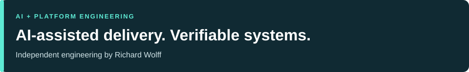
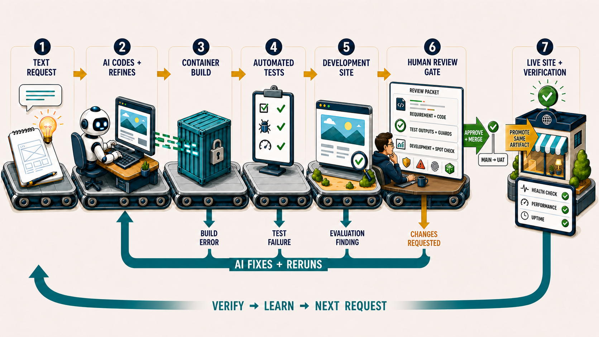

# Richard Wolff

**Technology Leader · Platform & AI Engineering**

  

[Engineering samples](#independent-engineering) · [Agentic delivery model](#how-i-approach-agentic-delivery) · [Application work](#application-work-and-engineering-judgment)

I build and adapt systems that make the results of AI-assisted work inspectable: what was requested, which bytes arrived, what was verified, and what a person is approving.

My independent projects connect that platform work to agent-assisted development, React/TypeScript applications and engineering judgment. Start with the two Python samples below: each isolates a concrete failure boundary from my personal tooling.

## Selected engineering: arrival and delivery

| Project | Engineering decision | Inspect the evidence |
| --- | --- | --- |
| [**Verified Artifact Collection**](https://github.com/wolffrichardj/verified-artifact-collection) · Python | Verify request identity and stored bytes; retain changed content instead of overwriting. Model post-publication uncertainty explicitly. | [Code and failure cases](https://github.com/wolffrichardj/verified-artifact-collection#ownership-boundaries) · [80-second walkthrough](https://github.com/wolffrichardj/verified-artifact-collection#80-second-walkthrough) |
| [**Exact Artifact Demo**](https://github.com/wolffrichardj/exact-artifact-demo) · Python | Package immutable Git source; reject changed payloads even after the outer archive hash is re-pinned. | [Validation boundaries](https://github.com/wolffrichardj/exact-artifact-demo#what-is-checked) · [80-second walkthrough](https://github.com/wolffrichardj/exact-artifact-demo#80-second-walkthrough) |

These separate samples extract and harden selected boundaries from my personal tooling, with AI assistance in adaptation and review. Collection uses offline synthetic records and an in-process MCP-shaped mock; Exact Artifact demonstrates packaging and validation against independently trusted expectations. They demonstrate local controls, with no live provider session, authenticated CI attestation or release activation. Commit identity does not establish per-line human authorship.

**Live sample checks:** Collection  · Exact Artifact 

## Application work and engineering judgment

[**Databricks Associate Study App**](https://github.com/wolffrichardj/databricks-associate-study-guide#engineering-proof-duplicate-question-selection) is a personal React and TypeScript project with browser-local study progress and focused quizzes.

Its engineering summary connects a real March 2026 change to public [selection code](https://github.com/wolffrichardj/databricks-associate-study-guide/blob/53a35a9d89da5755d94d1d2880f6023c4d6f90b0/src/lib/quiz.ts), [regression tests](https://github.com/wolffrichardj/databricks-associate-study-guide/blob/53a35a9d89da5755d94d1d2880f6023c4d6f90b0/src/test/quiz.test.ts), screenshots, and a dated validation record with its limits. The [development lessons](https://github.com/wolffrichardj/databricks-associate-study-guide/blob/53a35a9d89da5755d94d1d2880f6023c4d6f90b0/LESSONS_LEARNED.md) describe the agent-assisted workflow.

[**When an AI coach should stay silent**](https://richardwolff.me/resources/agentcoach/preview.html) is a source-reviewed engineering case study from the private AgentCoach project. It examines evidence, tentative inference and abstention using newly authored fictional illustrations. The alpha gate remains closed; product tests and coaching efficacy are not established by the case study.

[Shared agent workflows](https://github.com/wolffrichardj/shared-agent-workflows) collects workflows and skills gathered or adapted during personal projects. [Reinforce](https://github.com/wolffrichardj/shared-agent-workflows/tree/main/generic/skills/reinforce) is a published skill for routing reusable lessons to memory, workflow instructions, helpers, or canonical sources.

## How I approach agentic delivery

For my personal projects, I use agents to explore ambiguous intent and implementation, then move stable requirements into deterministic tests, interfaces and delivery controls. Evaluation checks whether the intended outcome happened. Explicit policy governs whether to fix, rerun, fall back, stop or ask for review.

My delivery model moves from a request through AI-assisted implementation, container build, automated tests and development-site evaluation. A **human review gate** brings together the requirement, implementation, test evidence, risks and visible behavior. Approval controls merge and promotion of the **same reviewed artifact** through UAT and production, followed by live verification. Useful lessons become maintained tests, controls and repository guidance.

View my personal delivery-loop model

This is the operating model I am developing for my personal projects. The correction loop runs during an active agent task; unattended resumption remains a pilot target. The two samples above demonstrate individual verification boundaries within that broader model.

## Community contribution

My [DerbyNet fork](https://github.com/wolffrichardj/derbynet) builds on the upstream race-management project. My work there centers on deployment and documentation; the underlying application is upstream work.

## Professional context and contact

- [Leadership case studies and background](https://richardwolff.me/)
- [LinkedIn](https://www.linkedin.com/in/wolffrichardj)
- [Email](mailto:wolffrichardj@gmail.com)

I’m interested in speaking engagements on AI and scalable solutions.

These are personal projects and practices, not employer policy or endorsement.
